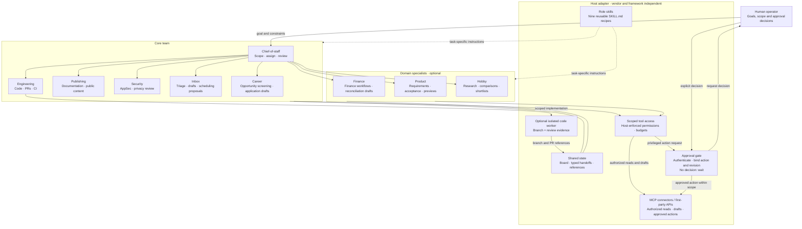

# Grok Bot Architecture: AI Agent Teams, Skills, MCP & Human Approval

[](https://github.com/tiagovilasboas/grok-bot-architecture/actions/workflows/ci.yml)
[](LICENSE)

**Grok Bot Architecture** is an independent, MIT-licensed reference for organizing **AI agent teams** with reusable **agent skills**, **MCP connectors**, and **human-in-the-loop approval**. Start with a chief-of-staff and scoped specialists, then use typed handoffs and persisted approval requests to coordinate work across local and remote hosts.

Looking for **Grok Bot multi-agent architecture**, **Grok Bot skills**, or a **chief-of-staff AI agent** pattern? This community project explains those design choices with portable role contracts and examples. It is not affiliated with xAI or Cursor and does not contain the Grok Bot product's source code. The architecture is model- and framework-independent; no API key is needed to validate its examples.

[Quick start](#quick-start) · [Walkthrough](examples/walkthrough.md) · [Architecture](docs/architecture.md) · [Grok Bot FAQ](docs/grok-bot-faq.md) · [Contributing](CONTRIBUTING.md) · [Security](SECURITY.md)

## From my personal setup to your own agent team

I built this reference from my personal use of a coordinated agent team: one role to scope and review work, specialists for engineering, publishing, security, inbox and career tasks, and optional roles for finance, product work and hobbies. The public examples use generic English names and fictional resources; my accounts, private projects and day-to-day data are not configuration requirements.

The aim is to give you a useful starting point for your own work. **Everything in the setup is customizable:** role names and responsibilities, how many agents you run, skills, tools, models, frameworks, storage, routines, budgets, batch sizes, review criteria and approval policies. Start with the parts that solve a real problem for you, adapt their boundaries to your host, and leave the rest out.

This is a personal approach shared with the community under MIT, rather than a claim that nine agents are the right structure for everyone. See the [customization guide](docs/customization.md) for an adoption path and a reusable role template.

## What you can use today

- **Seven accepted architecture decisions**, plus proposed ADR 0007 for the approval-runtime spike.
- **Reusable role contracts** with a job, objective, and write boundary for every specialist.
- **Nine ready-to-load role skills** with procedures, output contracts, and quality review: [skill library](docs/skills.md).
- **Dependency-free JavaScript validators** for handoff and interrupt JSON records, with accepted and rejected examples.
- **Executable approval-runtime spike** that demonstrates one local, host-conformance lifecycle without a model or external service.
- **Adoption guides** for a first week, failure modes, and deciding when multiple agents are justified.
- **CI checks** for contract fixtures, the approval lifecycle example, and relative documentation links.

This is a reference architecture with executable contract checks. A consuming host must implement tool authorization, authenticated approvals, durable storage, and execution limits. Passing a JSON validator alone does not authorize an action or prove that a human approved it.

## Quick start

Requirements: Git and Node.js 20 or newer. The optional documentation link check additionally uses Bash; path resolution uses Node.js on both Linux and macOS.

```bash
git clone https://github.com/tiagovilasboas/grok-bot-architecture.git
cd grok-bot-architecture
node scripts/validate-all.mjs
node examples/approval-runtime/demo.mjs
node --test examples/approval-runtime/runtime.test.mjs
```

No package installation, external services, or credentials are required. The validator checks the bundled examples: intentionally broken records must be rejected and corrected records accepted. The demo is simulated, and the lifecycle tests use only temporary local files.

Check your own records separately:

```bash
node scripts/validate-handoff.mjs /path/to/handoff.json
node scripts/validate-interrupt.mjs /path/to/interrupt.json
```

These commands only validate files. They do not call connectors or execute the described action. Read the [complete walkthrough](examples/walkthrough.md) to follow a task from assignment to a pending approval and a rejected request.

## When this architecture helps

Use it when several jobs share infrastructure and their context, credentials, or write permissions need different boundaries: for example, inbox triage alongside engineering and publishing.

Start with a coordinator and one specialist. Add another role only when a concrete boundary justifies it. For one person working on one repository with one tool set, a single agent may be sufficient.

Use the [decision guide](docs/cookbook/when-to-use-this-pattern.md) before adding coordination.

## Architecture



Chief-of-staff coordinates five other Core team roles and three optional Domain specialists. Each role loads its own skill and works through scoped host permissions. Shared state carries assignments and evidence; privileged actions require an authenticated decision bound to the action and revision. Isolated code workers return review artifacts through Engineering.

See [architecture and trust boundaries](docs/architecture.md) and the [host integration contract](docs/host-integration.md).

## Roles: jobs, deliverables, and boundaries

My reference setup uses two groups: **Core team** (coordination and cross-cutting work) and optional **Domain specialists** (finance, product and hobby work). They are a menu to adapt, not a requirement to activate all nine agents.

| Role | Day-to-day job | Expected deliverable |
|---|---|---|
| **Chief-of-staff** | Turn goals into scoped assignments, prioritize the next increment, dispatch an owner, and review completion. | Assignment card, acceptance decision, blockers and concise next action. |
| **Engineering** | Implement scoped code and configuration changes, maintain CI, and package branches and pull requests for review. | Reviewable diff, required checks, implementation notes and residual risks. |
| **Publishing** | Improve public-facing READMEs, documentation, repository presentation, profiles and technical articles. | Source-backed draft or preview, checked links and clear publication status. |
| **Security** | Review application security and technical privacy within an explicitly authorized scope. | Evidence-backed findings with locations and remediation, or an explicit no-finding result. |
| **Inbox** | Review bounded batches of inbound messages and scheduling items, prioritize attention, and prepare drafts. | Digest, source references, proposed dispositions, replies and calendar proposals. |
| **Career** | Screen opportunities against supplied preferences, assess fit and prepare truthful tailored applications. | Ranked shortlist, requirement gaps, source links and application drafts. |
| **Finance** | Own finance-application requirements and reconcile authorized records into traceable drafts. | Requirements, reconciled totals, assumptions, discrepancy list and review references. |
| **Product** | Turn one application's user problems into prioritized increments, acceptance criteria and preview reviews. | Problem statement, scoped plan, implementation handoff and validation notes. |
| **Hobby** | Research discretionary interests, compare offers and explain value, availability and uncertainty. | Comparable shortlist with sources, dates, condition and total-price assumptions. |

Expand a role for its working contract. Full procedures live in the linked skill; the host enforces its actual permissions.

<details>
<summary><strong>Chief-of-staff</strong> — Core team coordinator</summary>

- **Job:** Turn goals into scoped assignments, prioritize the next increment, dispatch an owner, and review completion.
- **Required context:** User goal; existing authorization; constraints; board state; relevant specialist evidence.
- **Delivers:** Assignment card, acceptance decision, blockers and concise next action.
- **Boundary:** Do not become the default coder, publisher, or mailbox operator. Do not infer broad tool rights from the coordinator role.
- **Done when:** Every task has one owner; acceptance cites evidence; authority and outstanding blockers are explicit.

Example: “Choose the next documentation improvement and route it to the right specialist.”

[Load the Chief-of-staff skill](skills/chief-of-staff/SKILL.md).

</details>

<details>
<summary><strong>Engineering</strong> — Core team</summary>

- **Job:** Implement scoped code and configuration changes, maintain CI, and package branches and pull requests for review.
- **Required context:** Repository instructions; clean/dirty state; target behavior; authorized files and branch; acceptance criteria.
- **Delivers:** Reviewable diff, required checks, implementation notes and residual risks.
- **Boundary:** Commit as the actual contributor using repository policy. Do not force push, merge to default, tag, deploy, or change secrets without applicable authority. Bound external contributions by operator policy.
- **Done when:** Acceptance criteria are verified; checks are reported honestly; no unrelated edits or invented test results.

Example: “Fix the failing validation case and prepare a reviewable PR.”

[Load the Engineering skill](skills/engineering/SKILL.md).

</details>

<details>
<summary><strong>Publishing</strong> — Core team</summary>

- **Job:** Improve public-facing READMEs, documentation, repository presentation, profiles and technical articles.
- **Required context:** Audience; intended action; source material; verified project behavior; approved public scope.
- **Delivers:** Source-backed draft or preview, checked links and clear publication status.
- **Boundary:** Public publishing, profile mutation, default-branch merge, and outbound promotion require applicable authorization. Never invent stars, adoption, certifications, or savings.
- **Done when:** A new reader can explain what the project does, try the documented path, understand its limits, and identify the license.

Example: “Rewrite the project introduction so a new contributor can understand and try it.”

[Load the Publishing skill](skills/publishing/SKILL.md).

</details>

<details>
<summary><strong>Security</strong> — Core team</summary>

- **Job:** Review application security and technical privacy within an explicitly authorized scope.
- **Required context:** Explicit review scope; authorized systems; code/configuration evidence; threat model; data classification.
- **Delivers:** Evidence-backed findings with locations and remediation, or an explicit no-finding result.
- **Boundary:** No exploitation against live targets, disclosure of secrets, production mitigation, or destructive validation without specific authority. Technical privacy review is not legal certification.
- **Done when:** Every confirmed finding has evidence; no invented identifiers or vulnerabilities; no pressure to manufacture findings.

Example: “Check whether this approval flow lets an agent authorize its own action.”

[Load the Security skill](skills/security/SKILL.md).

</details>

<details>
<summary><strong>Inbox</strong> — Core team</summary>

- **Job:** Review bounded batches of inbound messages and scheduling items, prioritize attention, and prepare drafts.
- **Required context:** Authorized sources and date/filter window; priority criteria; batch limit; per-source read/label/draft permissions.
- **Delivers:** Digest, source references, proposed dispositions, replies and calendar proposals.
- **Boundary:** The human handles login, MFA, QR approval, and recovery. Never collect credentials in a board. Sending, invitations, or schedule changes require applicable authority.
- **Done when:** Every reviewed item has a disposition; deadlines are source-backed; no unsolicited send or private-body dump.

Example: “Review the authorized inbox window and draft replies to items needing a response.”

[Load the Inbox skill](skills/inbox/SKILL.md).

</details>

<details>
<summary><strong>Career</strong> — Core team</summary>

- **Job:** Screen opportunities against supplied preferences, assess fit and prepare truthful tailored applications.
- **Required context:** User-supplied constraints and approved professional facts; source listings; location/time-zone preferences; batch limits.
- **Delivers:** Ranked shortlist, requirement gaps, source links and application drafts.
- **Boundary:** No bulk applications by default. Submission, recruiter contact, profile changes, and interview scheduling require authority. Never invent experience or promise selection outcomes.
- **Done when:** Every recommendation maps to user criteria; professional claims are verifiable; drafts are not represented as submitted.

Example: “Compare these roles against my stated constraints and prepare one application draft.”

[Load the Career skill](skills/career/SKILL.md).

</details>

<details>
<summary><strong>Finance</strong> — Domain specialist</summary>

- **Job:** Own finance-application requirements and reconcile authorized records into traceable drafts.
- **Required context:** Authorized data sources; currency/period; reconciliation rules; product scope; permitted reads and drafts.
- **Delivers:** Requirements, reconciled totals, assumptions, discrepancy list and review references.
- **Boundary:** Payments, transfers, tax filing, bank access changes, and production writes require scoped authority. Keep financial and household data out of public examples.
- **Done when:** Totals are reproducible; assumptions and missing evidence are explicit; drafts never imply a completed transaction.

Example: “Reconcile this fictional expense export and flag missing or duplicate entries.”

[Load the Finance skill](skills/finance/SKILL.md).

</details>

<details>
<summary><strong>Product</strong> — Domain specialist</summary>

- **Job:** Turn one application's user problems into prioritized increments, acceptance criteria and preview reviews.
- **Required context:** Target users; evidence of a problem; application boundary; constraints; current backlog; success criteria.
- **Delivers:** Problem statement, scoped plan, implementation handoff and validation notes.
- **Boundary:** No unsupervised peer spawning. Publication, production changes, or default-branch merge follow host authorization. Do not invent user research or product metrics.
- **Done when:** The increment addresses an evidenced problem; scope is bounded; acceptance can be reviewed independently.

Example: “Define the smallest useful improvement to this onboarding flow and review the preview.”

[Load the Product skill](skills/product/SKILL.md).

</details>

<details>
<summary><strong>Hobby</strong> — Domain specialist</summary>

- **Job:** Research discretionary interests, compare offers and explain value, availability and uncertainty.
- **Required context:** User preferences; authorized research sources; budget/currency; location only when necessary; acceptable uncertainty.
- **Delivers:** Comparable shortlist with sources, dates, condition and total-price assumptions.
- **Boundary:** Purchase, bid, reservation, seller messaging, and disclosure of delivery/payment information require authority. No urgency claims without evidence.
- **Done when:** Options are comparable; prices are qualified; source uncertainty is visible; no purchase is implied.

Example: “Compare these collectible listings against the supplied budget and preferences.”

[Load the Hobby skill](skills/hobby/SKILL.md).

</details>

Use the [full role contracts](docs/crew/roles.md), [handoff format](docs/crew/handoffs.md), and [approval records](docs/crew/hitl.md) to adapt these jobs. Roles describe responsibilities; they do not create credential isolation, grant access, or replace a human authorization.

## Contract guarantees and limits

| Check | Current behavior | Host responsibility |
|---|---|---|
| Handoff structure | Requires an owner, goal, completion condition, references, and a recognized write-policy shape | Resolve roles, references, and actual tool permissions |
| Approval record | Validator checks record shape; runtime spike binds a decision to an action digest and host-supplied identity | Authenticate and authorize the approver; enforce revision preconditions at the point of the side effect |
| Timeout declaration | Requires `default_on_timeout: wait` | Actually pause execution and preserve state |
| Resume replay | Spike serializes calls in one runtime instance and consumes an approved record before execution | Use transactional storage or connector idempotency across processes and crashes |
| Lifecycle persistence | Spike stores local JSON records and recovers ambiguous execution as `outcome_unknown` | Protect records and use a concurrency-safe durable store |
| References | Requires an array of non-empty strings | Enforce allowed reference schemes, access, and data minimization |
| Remote work | Documents isolated code work and review handoff | Isolate credentials, files, processes, and network access |

The JSON checkers validate individual records. They do not implement a workflow engine or authenticate identities. The runtime spike exercises only a bounded local lifecycle; it is not a production authorization boundary and does not guarantee safe concurrent execution across processes.

## Approval runtime spike

The [runtime roadmap](docs/runtime-roadmap.md) tracks the next step beyond record validation. The [local reference example](examples/approval-runtime/README.md) demonstrates persisted approval state, a host-supplied human identity, approval bound to an exact action revision, fail-closed cancellation and expiry, and one-shot resume within one runtime instance.

It is an educational host-conformance example, not a production runtime or security boundary. Its local file store is single-process; authentication, resource authorization, multi-process transactions, connector idempotency, and reconciliation remain responsibilities of a consuming host. The example does not call a model or perform a real external side effect.

## Documentation

| Start here | What you get |
|---|---|
| [Architecture](docs/architecture.md) | Layers, ownership, and trust boundaries |
| [ADRs](docs/adr/README.md) | Seven accepted decisions and one proposed runtime spike |
| [Walkthrough](examples/walkthrough.md) | A complete fictional task lifecycle |
| [Host integration](docs/host-integration.md) | What an adapter must enforce |
| [Grok Bot host mapping](docs/hosts/grok-bot/mapping.md) | What Grok Bot enforces and what stays a convention |
| [Approval runtime example](examples/approval-runtime/README.md) | Local host-conformance lifecycle spike |
| [Runtime roadmap](docs/runtime-roadmap.md) | Current spike, limits, and ordered follow-up tasks |
| [Customize your setup](docs/customization.md) | Adapt roles, skills, tools, routines and policies |
| [Agent contributor instructions](AGENTS.md) | Shared repository workflow; Claude entry point in [CLAUDE.md](CLAUDE.md) |
| [First week](docs/cookbook/first-week.md) | Adopt a small crew progressively |
| [Failure modes](docs/cookbook/failure-modes.md) | Context waste, excess delegation, and silent approval |
| [Connectors](docs/connectors.md) | MCP/API boundaries and least privilege |
| [Security design](docs/security.md) | Untrusted inputs and privileged operations |
| [Context engineering](docs/context-engineering.md) | References, budgets, and bounded context |

## Grok Bot questions

### What is Grok Bot?

The [official Grok Bot overview](https://docs.x.ai/grok-bot/overview) describes persistent AI teammates that work across connected apps and a shared computer. This repository is an independent architecture reference for organizing that kind of work. Product installation, pricing, and account support belong in the official documentation.

### Is this an open-source Grok Bot implementation?

This reference architecture, its nine role skills, and its local validators are open source under MIT. They are not the Grok Bot service, its backend, an official SDK, or a reverse-engineered implementation.

### How do I organize a Grok Bot team?

Start with Chief-of-staff plus the specialist needed for one task. Define its scope, references, permitted actions, and completion criteria. Use the [nine role contracts](docs/crew/roles.md) and [skill library](docs/skills.md) as recipes; map them to the host's supported tools and approval mechanisms.

### Can I use the agent skills with another model or framework?

Yes. The files are portable instructions and contracts. Adapt tool names, state storage, and skill loading to your host. Compatibility with a specific host needs verification; copying a skill does not install an integration or enforce permissions.

### Do separate bots isolate secrets and tool access?

Role names alone do not create isolation. The host must enforce permissions and data boundaries. On a shared computer, review which files, credentials, and sessions each bot can actually reach. See [host integration](docs/host-integration.md) and the [Grok Bot FAQ](docs/grok-bot-faq.md).

More questions: [Grok Bot skills, MCP, routines, and approval FAQ](docs/grok-bot-faq.md).

## Contribute and get help

Start with [CONTRIBUTING.md](CONTRIBUTING.md). Small documentation fixes, anonymized adoption reports, and missing negative fixtures are useful contributions. Propose architecture changes through an ADR; use branches and pull requests.

- [Report a bug or improve the docs](https://github.com/tiagovilasboas/grok-bot-architecture/issues/new/choose)
- [Support](SUPPORT.md) and [Code of Conduct](CODE_OF_CONDUCT.md)
- [Report a security concern privately](SECURITY.md)
- [Changes and follow-up priorities](CHANGELOG.md)

Stars and forks indicate interest, not verified production adoption. The repository does not publish measured productivity, security, or cost improvements without supporting evidence.

## License

[MIT License](LICENSE), copyright © 2026 Tiago Vilas Boas. You may use, modify, and redistribute the project, including commercially, under the license terms.

Maintained by [Tiago Vilas Boas](https://github.com/tiagovilasboas). Contributions are welcome from any agent ecosystem.
