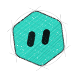
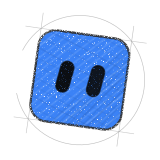
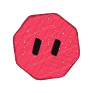
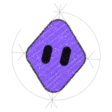
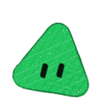
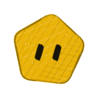
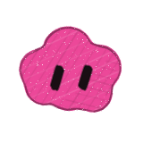

# Crew heads

These are standalone SVGs of the nine crew role heads used in the README visuals, one file per role.
Each file is a transparent 160 × 160 canvas that works on dark and light pages and carries a `<title>` for screen readers.
Like the rest of the repository, they are MIT-licensed. You can use them as agent avatars in your own host UI, or recolor and rename them to fit your roles.

| Head | Role | Shape | Color | File |
|---|---|---|---|---|
|  | Chief-of-staff | hexagon | `#2DD4BF` | [chief-of-staff.svg](chief-of-staff.svg) |
|  | Engineering | square | `#3B82F6` | [engineering.svg](engineering.svg) |
|  | Publishing | circle | `#F59E0B` | [publishing.svg](publishing.svg) |
|  | Security | octagon | `#F43F5E` | [security.svg](security.svg) |
|  | Inbox | diamond | `#8B5CF6` | [inbox.svg](inbox.svg) |
|  | Career | triangle | `#22C55E` | [career.svg](career.svg) |
|  | Finance | pentagon | `#EAB308` | [finance.svg](finance.svg) |
|  | Product | egg | `#0EA5E9` | [product.svg](product.svg) |
|  | Hobby | cloud | `#EC4899` | [hobby.svg](hobby.svg) |

Each role keeps the same shape, color, tilt and eyes in every visual, so a head identifies its role wherever it appears.
Orbi, the project mascot, is the Chief-of-staff hexagon; see [mascot.svg](../mascot.svg).

The artwork is original. It is not affiliated with or endorsed by xAI.
